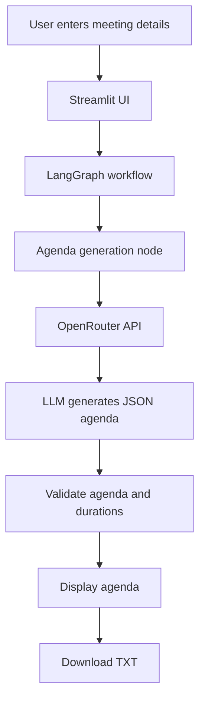

# Smart Meeting Agenda Creator

An AI-powered meeting agenda generator built with Python, LangGraph, OpenRouter, and Streamlit. It transforms meeting objectives and context into structured agendas with discussion points, time allocations, and expected outcomes.

## Features

- **AI-powered agenda generation** — creates agendas based on meeting objectives and context.
- **Multiple meeting types** — supports team meetings, project planning, brainstorming, client meetings, sprint reviews, and more.
- **Time allocation** — assigns durations to individual agenda items.
- **Discussion points** — provides relevant topics for each agenda item.
- **Expected outcomes** — defines the intended result of each discussion.
- **Duration validation** — checks whether the total agenda duration matches the requested meeting duration.
- **Agenda download** — exports the generated agenda as a text file.
- **Simple interface** — an interactive Streamlit frontend with no database or authentication required.

## Tech Stack

| Technology | Purpose |
|---|---|
| Python | Core application logic |
| LangGraph | LLM workflow orchestration |
| LangChain OpenAI integration | Connects to OpenRouter's OpenAI-compatible API |
| OpenRouter | Access to supported language models |
| Streamlit | User interface |
| python-dotenv | Environment variable management |

## Architecture



The application uses a single-node LangGraph workflow. Meeting details are passed to the LLM, which generates a structured agenda. The application validates the response before displaying it.

## Project Structure

```text
smart-meeting-agenda/
├── app.py              # Streamlit application
├── graph.py            # LangGraph workflow and validation
├── prompts.py          # LLM instructions
├── config.py           # OpenRouter configuration
├── requirements.txt    # Python dependencies
├── .env.example        # Environment variable template
├── .gitignore          # Excludes secrets and local files
└── README.md           # Project documentation
```

## Getting Started

### Prerequisites

- Python 3.10 or newer
- Git
- An OpenRouter account and API key
- An available OpenRouter model, preferably a free model for initial testing

### 1. Clone the repository

```bash
git clone https://github.com/Nirmal0804/Smart-Meeting-Agenda-Creator.git
cd Smart-Meeting-Agenda-Creator
```

### 2. Create a virtual environment

**Windows PowerShell:**

```powershell
py -m venv .venv
.venv\Scripts\Activate.ps1
```

If PowerShell blocks activation, use Command Prompt:

```bat
.venv\Scripts\activate.bat
```

### 3. Install dependencies

```bash
python -m pip install -r requirements.txt
```

### 4. Configure environment variables

Create a `.env` file in the project root. Use `.env.example` as a template if available.

```env
OPENROUTER_API_KEY=your_openrouter_api_key
OPENROUTER_MODEL=openrouter/free
```

Get an API key from [OpenRouter](https://openrouter.ai/).

The `openrouter/free` model router attempts to select an available free model. Free model availability, rate limits, and supported features can vary.

**Security:** Never commit your `.env` file or expose your API key in source code, screenshots, logs, or public repositories.

### 5. Run the application

```bash
python -m streamlit run app.py
```

Open the local URL displayed in the terminal, usually:

```text
http://localhost:8501
```

## How to Use

1. Enter the meeting title and objective.
2. Select the meeting type.
3. Specify the participants or their roles.
4. Set the total meeting duration.
5. Add optional context, priorities, or constraints.
6. Click **Generate Agenda**.
7. Review the agenda items, discussion points, and expected outcomes.
8. Download the agenda as a `.txt` file.

## Example

**Meeting:** College Project Planning

**Objective:** Finalize the MVP scope and identify next steps.

**Duration:** 30 minutes

Example agenda:

| Agenda item | Duration |
|---|---:|
| Opening and objectives | 3 min |
| Review project scope | 8 min |
| Prioritize MVP features | 10 min |
| Identify blockers and next steps | 6 min |
| Wrap-up | 3 min |
| **Total** | **30 min** |

The actual agenda is generated dynamically according to the supplied meeting details.

## Error Handling

The application handles common issues, including:

- Missing API credentials
- API request failures
- Invalid JSON responses
- Invalid agenda item durations
- Total agenda duration mismatches
- Missing required meeting information

Free models may be temporarily unavailable or subject to provider-specific limits. If generation fails, verify your API configuration and the model's current availability.

## Current Scope

This is a lightweight MVP designed to demonstrate LLM integration and workflow orchestration.

It intentionally does not include:

- User authentication
- Persistent database storage
- Retrieval-augmented generation (RAG)
- Multi-agent orchestration
- Calendar integrations
- Automatic meeting transcription

## Future Improvements

- Regenerate individual agenda items.
- Edit agenda items before downloading.
- Add PDF export.
- Add agenda refinement through natural-language instructions.
- Save and retrieve previously generated agendas.
- Add automated tests for prompts, workflow execution, and duration validation.

## Learning Objectives

This project demonstrates practical use of:

- Prompt engineering for structured LLM output
- OpenRouter API integration
- LangGraph state and node-based workflows
- JSON parsing and validation
- Python environment configuration
- Building an interactive AI application with Streamlit

## License

This project is available under the MIT License if a corresponding `LICENSE` file is included in the repository.

---

Built with Python, LangGraph, and OpenRouter.

